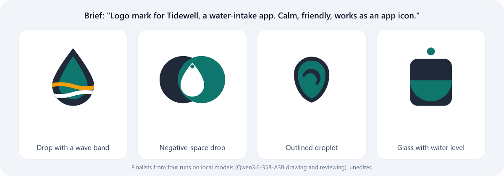
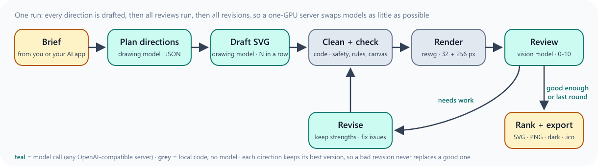
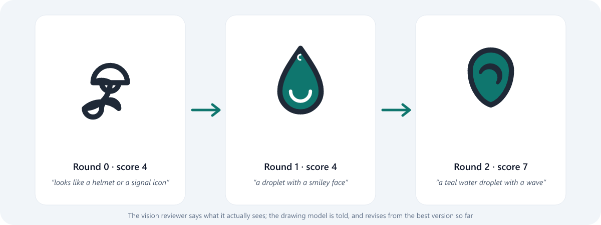
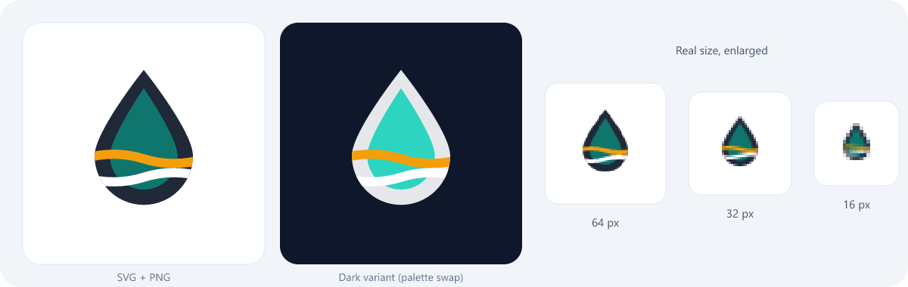

# SVGLoop

**An MCP server that draws logos and icons as clean, editable SVG with your own local models.**

SVGLoop doesn't need an image-generation model. It uses the same loop a human designer uses: plan a few directions, draw each one as SVG code, render it, have a vision model look at the render, fix what's wrong, and keep the best. Everything runs on your machine against any OpenAI-compatible server (llama.cpp, Ollama, LM Studio, …).



- **Real vector output:** small, hand-editable SVG that stays sharp at any size, not a raster image to trace.
- **Self-checking:** every draft is rendered and reviewed by a vision model at app-icon *and* favicon size.
- **Safe by construction:** model-written SVG is sanitized before it is rendered or saved.
- **Fits any MCP client:** Claude Desktop, Claude Code, VS Code, OpenCode, or your own app. There's also a command line and a TypeScript library.
- **Ready-to-use exports:** SVG, PNGs from 16 to 512 px, a dark-mode variant and a Windows `.ico`.

---

## How it works



1. **Plan:** the model proposes N clearly different directions for your brief (JSON).
2. **Draft:** each direction is drawn as SVG under strict rules: one canvas, your palette, a shape limit, a margin, no text (letters as paths).
3. **Clean and check:** code, not a model, strips anything unsafe and checks the rules. It also renders the drawing to find blank, tiny or clipped artwork.
4. **Review:** a vision model sees the mark at 256 px and at 32 px (enlarged with hard pixels, so it judges real small-size legibility). It says what it actually sees, then lists strengths, problems and fixes, and scores 0–10 against your brief.
5. **Revise:** weak drafts go back to the drawing model with the problems, the strengths to keep, and what a viewer currently sees. Each direction keeps its best version, so a bad revision never replaces a good one.
6. **Rank and export:** the best directions come back as finalists.

Here is one direction improving over two revision rounds, with the reviewer's own words:



Model calls are batched: all drafts, then all reviews, then all revisions. On a single GPU, a server that swaps between a drawing model and a vision model swaps as rarely as possible. Using one multimodal model for both jobs avoids swaps entirely.

---

## Requirements

- **A model server** with an OpenAI-compatible `/v1/chat/completions` endpoint and a model that **accepts images** (for the review step). One multimodal model can do both drawing and reviewing.
- **One of:**
  - **Node.js 20.3+** to run it with `npx` (no install step), or
  - a **standalone binary** from [Releases](../../releases) (no runtime needed).

### Start a local model (llama.cpp example)

```bash
llama-server -m your-model.gguf --mmproj your-model-mmproj.gguf --port 8080 -c 16384 --jinja
```

`--mmproj` loads the vision part; without it the review step can't see the drawings. [`scripts/start-llama.ps1`](scripts/start-llama.ps1) and [`scripts/start-llama.sh`](scripts/start-llama.sh) wrap this with sensible defaults, including a VRAM headroom option.

Other servers work the same way: point `SVGLOOP_BASE_URL` at them, for example `http://127.0.0.1:11434/v1` for Ollama or `http://127.0.0.1:1234/v1` for LM Studio.

---

## Add it to your MCP client

Set at least `SVGLOOP_BASE_URL` and `SVGLOOP_MODEL`. The model name must be one your server knows.

**Claude Desktop** (`claude_desktop_config.json`), Cursor and other clients that use `mcpServers`:

```json
{
  "mcpServers": {
    "svgloop": {
      "command": "npx",
      "args": ["-y", "svgloop", "mcp"],
      "env": {
        "SVGLOOP_BASE_URL": "http://127.0.0.1:8080/v1",
        "SVGLOOP_MODEL": "your-model-name"
      }
    }
  }
}
```

On Windows, some clients need `"command": "cmd"` with `"args": ["/c", "npx", "-y", "svgloop", "mcp"]`.

**Claude Code:**

```bash
claude mcp add svgloop -e SVGLOOP_BASE_URL=http://127.0.0.1:8080/v1 -e SVGLOOP_MODEL=your-model-name -- npx -y svgloop mcp
```

**VS Code** (`.vscode/mcp.json`):

```json
{
  "servers": {
    "svgloop": {
      "type": "stdio",
      "command": "npx",
      "args": ["-y", "svgloop", "mcp"],
      "env": { "SVGLOOP_BASE_URL": "http://127.0.0.1:8080/v1", "SVGLOOP_MODEL": "your-model-name" }
    }
  }
}
```

**OpenCode** (`opencode.json`):

```json
{
  "mcp": {
    "svgloop": {
      "type": "local",
      "command": ["npx", "-y", "svgloop", "mcp"],
      "environment": { "SVGLOOP_BASE_URL": "http://127.0.0.1:8080/v1", "SVGLOOP_MODEL": "your-model-name" },
      "enabled": true,
      "timeout": 90000
    }
  }
}
```

**Standalone binary:** use the binary's path as `command` and `["mcp"]` as `args`. It also reads an `svgloop.config.json` placed next to it.

Then ask your assistant something like:

> Make a logo for Tidewell, a small app that tracks water intake. Calm and friendly; it has to work as an app icon.

---

## Tools

| Tool | What it does | Main parameters |
|---|---|---|
| `make_graphic` | Starts a run and returns a `job_id` at once (runs take minutes, longer than most clients allow a single call to take). | `brief`; optional `candidates` (1–8), `rounds` (0–5), `keep`; for revisions `start_svg` + `feedback` |
| `graphic_status` | Waits up to `wait_seconds` (default 25, max 55) and reports progress. When done, it returns the finalists' SVG code, scores, reviewer notes, file paths and preview images. | `job_id`, `wait_seconds`, `include_images` |
| `stop_graphic` | Stops a run after the current model call. | `job_id` |
| `render_svg` | Cleans, checks and renders any SVG and returns the images, so a client's own model can draw and look at its work. | `svg`, `sizes`, `background` |
| `export_graphic` | Writes final files: SVG, PNGs, dark variant, `.ico`. | `svg`, `name` |

Jobs run one at a time, so a single GPU never serves two runs at once.



---

## Command line

The same program works from a terminal:

```bash
npx svgloop make --brief "Logo mark for Tidewell, a water tracker app"
npx svgloop make --brief "..." --start out/run-.../final-1.svg --feedback "rounder, less orange"
npx svgloop validate logo.svg          # rule and safety check, canvas problems
npx svgloop render logo.svg --sizes 32,256
npx svgloop export logo.svg --name tidewell
npx svgloop ping                       # do the model endpoints answer?
```

Add `--json` for machine-readable output, so any program in any language can call it. Each `make` run writes a folder containing every draft (`c<n>-r<round>.svg/.png`), the plan (`concepts.json`), the finalists (`final-<n>.svg/.png`) and `result.json` with every score and reviewer note.

---

## Configuration

Settings come from environment variables, a config file, or both (environment variables win).

### Environment variables

| Variable | Meaning |
|---|---|
| `SVGLOOP_BASE_URL` | OpenAI-compatible base URL, e.g. `http://127.0.0.1:8080/v1` |
| `SVGLOOP_MODEL` | Model name, used for drawing and reviewing |
| `SVGLOOP_API_KEY` | Optional bearer key |
| `SVGLOOP_VISION_BASE_URL`, `SVGLOOP_VISION_MODEL`, `SVGLOOP_VISION_API_KEY` | Use a different model (or server) for the review step |
| `SVGLOOP_EXTRA_BODY` | JSON merged into every request. For thinking models on llama.cpp: `{"chat_template_kwargs":{"enable_thinking":false}}` |
| `SVGLOOP_OUT_DIR` | Where results go. Default: `~/SVGLoop` (or `out/` next to a config file) |
| `SVGLOOP_CONFIG` | Path to a config file |

### Config file

The config file is found via `--config`, then `$SVGLOOP_CONFIG`, then `./svgloop.config.json`, then `svgloop.config.json` next to the program. Start from [`svgloop.config.example.json`](svgloop.config.example.json). Any string can use `{env:NAME}` to read an environment variable, which is handy when a host app starts the model server on a random port with a fresh key.

| Key | Default | Meaning |
|---|---|---|
| `coder`, `vision` | — | Endpoints: `baseURL`, `model`, `apiKey`, `temperature`, `maxTokens`, `timeoutMs`, `extraBody` (sent as-is, e.g. `{"chat_template_kwargs":{"enable_thinking":false}}`) |
| `palette` | 4 colours | `{name, value, dark?}`; drawings may only use these. `dark` values make the dark variant |
| `strictPalette` | `false` | Off-palette colours are errors instead of warnings |
| `candidates` / `rounds` / `keep` | 3 / 2 / 2 | Directions per run / revision passes / finalists returned |
| `goodEnough` | 8 | Review score at which a direction stops being revised |
| `maxElements` | 24 | Shape limit |
| `canvas` | 256 | viewBox size |
| `reviewSizes` / `exportSizes` | [32, 256] / 16…512 | Sizes shown to the reviewer / written on export |
| `examplesDir`, `styleFile` | shipped | Your style references (below) |
| `outDir` | see above | Results folder |

### Teach it your taste

- **`examples/`:** SVGs you like. The two most relevant ones (matched by file name and an optional `<!-- tags: a, b -->` comment) are shown to the model as style references. This is the biggest quality lever: replace the starters with marks you love.
- **`style.md`:** short house rules included in every prompt.

Point `examplesDir` and `styleFile` at your own copies in the config file.

---

## Models: what to expect

SVGLoop's quality depends on your model. These are the results from development testing on a single 16 GB consumer GPU:

| Model | Result |
|---|---|
| **Qwen3.6-35B-A3B** (MoE, one model for both jobs) | Best tested. About 50 tokens/s with part of the model in system RAM. A 2-direction run took about 2 minutes end to end; 3 directions × 2 rounds about 2.5 minutes. Revisions raised scores (e.g. 4→7, 6→8). |
| **Gemma 4 12B** | Fast, with sharp reviews, but its revisions rarely improved a draft. |
| **Dense ~27B, partly offloaded** | Too slow (about 4 tokens/s): a run would take around half an hour. Prefer MoE models when VRAM is tight. |

Tips:
- Turn thinking off for drawing calls (`SVGLOOP_EXTRA_BODY` or `extraBody` above). It costs tokens and doesn't help the SVG.
- Reviews vary by about ±2 points between runs of the same drawing. Several candidates per run absorb that.
- llama.cpp is the tested server. Ollama and LM Studio speak the same API but haven't been tested yet; reports welcome.

---

## Safety

Every SVG a model writes passes through `cleanSvg` before it is rendered or written to disk. It removes:

- scripts and event handlers (`on*`)
- `foreignObject` and `<image>`
- outside `href` and `url()` references
- `DOCTYPE` and `ENTITY` declarations
- any element or attribute not on an allow-list

Rendering uses [resvg](https://github.com/linebender/resvg), which runs no scripts and fetches nothing. MCP exports are written only inside the configured output folder. See [SECURITY.md](SECURITY.md) to report a problem.

## Limitations

- Results are as good as your local model. Expect clean, geometric marks, not detailed illustration.
- Drawings that use `<text>` depend on installed fonts. The prompts ask for letters drawn as paths.
- One job runs at a time per server process.

---

## Use as a library

```ts
import { loadConfig, makeGraphic, exportGraphic } from "svgloop";

const cfg = loadConfig(); // env vars and/or svgloop.config.json
const run = await makeGraphic(cfg, { brief: "Logo mark for Tidewell" }, (e) => console.log(e.message));
exportGraphic(cfg, run.finalists[0].svg, "tidewell");
```

## Development

```bash
bun install
bun test            # offline: a stand-in model server, MCP round trip included
bun run build:node  # dist/cli.js for npm/npx
bun run build:exe   # standalone binary for this platform
```

## Contributing

Contributions are welcome. Please read [CONTRIBUTING.md](CONTRIBUTING.md). Contributors sign a short [Contributor License Agreement](CLA.md), and a bot asks for it on your first pull request.

## License

[Apache-2.0](LICENSE). Third-party components are listed in [THIRD_PARTY_NOTICES.md](THIRD_PARTY_NOTICES.md).
